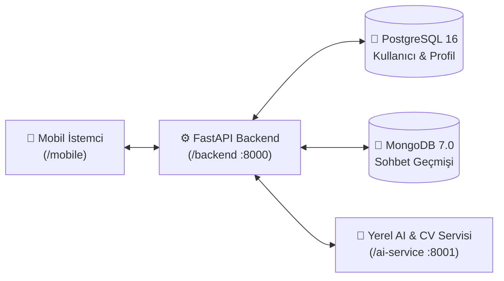

# 🥗 DietAI — Yapay Zekâ Destekli Diyet ve Beslenme Yönetim Sistemi
> **Graduation Project / Bitirme Projesi**  
> *Akıllı telefon kamerasıyla yemek tanıma, porsiyon tahmini, kişiselleştirilmiş diyet planlama ve etik güvenlik sınırlı yapay zekâ danışmanı.*

---

## 👥 Ekip Kadrosu ve Sorumluluk Dağılımı

| Mühendis | Rol | Birincil Dizin | Temel Teknolojiler | Sorumluluk Alanı |
| :--- | :--- | :--- | :--- | :--- |
| **Bertan Beyal** | Mobil & Ön Yüz (Frontend) | [`/mobile`](mobile/README.md) | React Native, Expo, TypeScript | Hem iOS hem Android uyumlu mobil istemci, akıllı kamera vizörü, Expo Go testleri, diyet paneli ve kullanıcı deneyimi. |
| **Ali Eren Özer** | Arka Yüz (Backend) & Veritabanı | [`/backend`](backend/README.md) | FastAPI, PostgreSQL, MongoDB, SQLAlchemy | RESTful API mimarisi, çoklu veritabanı katmanı, JWT kimlik doğrulama, BMR/TDEE hesaplayıcı, sohbet belleği ve AI ara katmanı. |
| **Eren Torman** | Yapay Zekâ (AI / CV & LLM) | `/ai-service` | Python, OpenCV, Yerel LLM | Görüntüden yemek ve porsiyon tahmini, yerel diyetisyen dil modeli servisi ve yapay zekâ çıkarım katmanı. |

> **Detaylı Teknik Rehberler:**
> * ⚙️ **Backend, API Uç Noktaları ve AI Servisi Sözleşmeleri:** [`backend/README.md`](backend/README.md)
> * 📱 **Mobil Mimari ve Ekran Rehberi:** [`mobile/README.md`](mobile/README.md)
> * 📚 **Proje Dokümantasyon Merkezi:** [`docs/obsidian/00-Ana-Giris.md`](docs/obsidian/00-Ana-Giris.md)

---

## 🏛️ Sistem Mimarisi (Genel Bakış)

Uygulama, cep telefonunda çalışan mobil istemci ile sunucu tarafındaki FastAPI arka yüzü, PostgreSQL + MongoDB veritabanları ve yerel yapay zekâ servisinin haberleştiği **İstemci - Sunucu (Client-Server)** mimarisine sahiptir:



*(Uçtan uca teknik akışlar ve JSON sözleşmeleri için [`backend/README.md`](backend/README.md) dosyasına bakınız).*

---

## 🚀 Hızlı Kurulum ve Çalıştırma

### 1. Tek Komutla Tüm Altyapıyı Başlatma (Docker İle)
```bash
docker compose up -d
```
* **PostgreSQL:** `localhost:5432`
* **MongoDB:** `localhost:27017`
* **Backend API & Swagger:** `http://localhost:8000/api/v1/docs`
* **AI Servisi:** `http://localhost:8001/health`

Kapatmak için: `docker compose down`

### 2. Modülleri Ayrı Ayrı Çalıştırma
* **Mobil (`/mobile`):** `cd mobile && npm install && npx expo start` (detaylar: [`mobile/README.md`](mobile/README.md))
* **Backend (`/backend`):** `cd backend && pip install -r requirements.txt && uvicorn app.main:app --reload --port 8000` (detaylar: [`backend/README.md`](backend/README.md))
* **AI Servisi (`/ai-service`):** `cd ai-service && pip install -r requirements.txt && uvicorn server:app --reload --port 8001`

---

## 🌿 Ekip İçi Git & Dal (Branching) Kuralları

Depoda `main` dalı koruma altındadır. Değişiklikler özellik dallarında geliştirilip **Pull Request (PR)** ile `main` dalına birleştirilir:

```bash
git checkout main
git pull origin main
git checkout -b feat/yeni-ozellik
# ... geliştirme ve test ...
git add .
git commit -m "feat(modül): kısa açıklama"
git push origin feat/yeni-ozellik
```

---

## 🛡️ Etik ve Yasal Güvenlik Sınırları (Guardrails)

1. **Tıbbi Teşhis Yasağı:** Chatbot kesinlikle tıbbi tanı koyamaz ve ilaç/reçete öneremez.
2. **Güvenli Kalori Sınırı:** Sağlığı riske atan aşırı düşük kalorili şok diyetler tavsiye edilemez.
3. **Yasal Sorumluluk Reddi:** Mobil ekranda ve API yanıtlarında *"Tüm tahminler yapay zekâ modeli tarafından sunulmakta olup hekim veya klinik diyetisyen reçetesi yerine geçmez"* uyarısı zorunludur.
