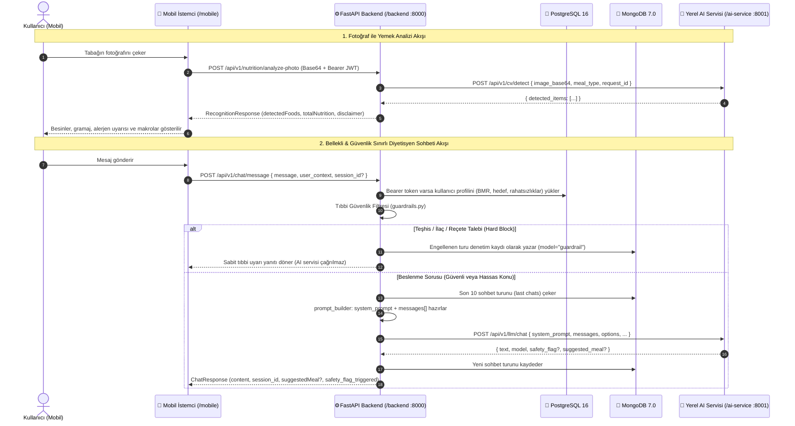

# 🥗 DietAI — Yapay Zekâ Destekli Diyet ve Beslenme Yönetim Sistemi

> **Graduation Project / Bitirme Projesi**  
> *Akıllı telefon kamerasıyla yemek tanıma, porsiyon tahmini, klinik BMR/TDEE temelli kişiselleştirilmiş beslenme takibi ve etik güvenlik sınırlı yerel yapay zekâ diyetisyen asistanı.*

---

## 👥 Ekip Kadrosu ve Modül Durumu

| Mühendis | Rol | Birincil Dizin | Temel Teknolojiler | Güncel Durum |
| :--- | :--- | :--- | :--- | :--- |
| **Bertan Beyal** | Mobil & Ön Yüz (Frontend) | [`/mobile`](mobile/README.md) | React Native, Expo, TypeScript, Zustand, SecureStore | ✅ Tamamlandı & Birleştirildi |
| **Ali Eren Özer** | Arka Yüz (Backend) & Veritabanı | [`/backend`](backend/README.md) | FastAPI, PostgreSQL 16, MongoDB 7.0, SQLAlchemy 2.0, Beanie ODM | ✅ Tamamlandı & Test Edildi (12/12 pytest) |
| **Eren Torman** | Yapay Zekâ (Local LLM & CV) | `/ai-service` | Python, FastAPI, Yerel LLM (Ollama/vLLM/vb.), OpenCV / Vision | 🚧 Sıradaki Aşama — API Sözleşmeleri Hazır |

> **Modül Bazlı Detaylı Rehberler:**
> * ⚙️ **Backend & AI Sözleşmeleri:** [`backend/README.md`](backend/README.md)
> * 📱 **Mobil Mimari & Bileşen Rehberi:** [`mobile/README.md`](mobile/README.md)
> * 📚 **Obsidian Dokümantasyon Merkezi:** [`docs/obsidian/00-Ana-Giris.md`](docs/obsidian/00-Ana-Giris.md)

---

## 📦 Son Commit'lerle Tamamlanan Özellikler (Proje Özeti)

### 1. Mobil İstemci (`/mobile`)
* **Modern Bento Dashboard & OLED Karanlık Mod:** Canlı kalori halkası, makro çubukları, su sayacı, canlı tarih şeridi, animasyonlu açılış ekranı ve **gece yarısı otomatik günlük sıfırlama** (daily midnight rollover).
* **3 Aşamalı Onboarding & Klinik BMR Motoru:** Backend ile 1:1 uyumlu çift formül geçişi ($\text{BMI} \le 30$ için **Revised Harris-Benedict**, $\text{BMI} > 30$ için **Mifflin-St Jeor**), spor sıklığı eşlemesi, yaşa göre ideal kilo ve kronik rahatsızlık bayrakları (diyabet, kolesterol, hipertansiyon).
* **Kamera, Barkod & Tarif Araçları:** Fotoğraf analiz vizörü, **Open Food Facts** barkod tarayıcı, porsiyon düzenleme modalı (`EditPortionModal`), özel tarif oluşturucu (`RecipeBuilderModal`), besin arama, alerjen/klinik uyarı motoru (`allergenMatcher.ts`) ve 7 günlük SVG analiz grafikleri.
* **Güvenlik & Çevrimdışı Dayanıklılık:** `Zustand` + `AsyncStorage` ile yerel kalıcılık, `expo-secure-store` donanım şifreli JWT saklama, `401` durumunda otomatik `POST /api/v1/auth/refresh` yenileme ve canlı (production) build'lerde zorunlu HTTPS kontrolü.

### 2. FastAPI Backend & Çoklu Veritabanı Katmanı (`/backend`)
* **Polyglot Veritabanı Mimarisi:**
  * **PostgreSQL 16 (`SQLAlchemy 2.0`):** `users`, `user_profiles`, `meal_logs` ve `meal_food_items` tabloları.
  * **MongoDB 7.0 (`Motor` + `Beanie ODM`):** `chat_logs` koleksiyonunda kullanıcıların **son sohbet geçmişi (conversation memory)**, günlük diyet bağlamı anlık görüntüsü ve tıbbi güvenlik denetim kayıtları. *(MongoDB yerelde açık değilse geliştirme ortamı için otomatik bellek içi fallback devreye girer).*
* **Kimlik Doğrulama & Profil Senkronizasyonu:** `POST /auth/register`, `POST /auth/login`, `POST /auth/refresh`, `GET /auth/me`, `GET/PUT /users/me/profile`. Giriş yapmış kullanıcı `POST /nutrition/calculate-bmr` çağırdığında profili PostgreSQL'e otomatik kaydedilir (`is_onboarded = true`).
* **Klinik Hesaplama, Öğün Planı & Fotoğraf Proxy:** BMR/TDEE/İdeal Kilo/Değişim hesaplayıcıları, kullanıcının hedef kalorisine uyarlanan 7 günlük `GET /nutrition/meal-plan` ve Base64 doğrulamalı `POST /nutrition/analyze-photo` (AI servisine iletir).
* **Sohbet Ara Katmanı (Middleware) & Yerel AI Orkestrasyonu:**
  * `POST /chat/message`, `GET /chat/history`, `DELETE /chat/history`.
  * Türkçe büyük/küçük harf ve aksan duyarsız tıbbi güvenlik filtresi (`guardrails.py`): Teşhis/reçete/ilaç sorularını AI servisini hiç çağırmadan engeller; hassas sağlık konularında ek güvenlik talimatı enjekte eder ve `safety_flag_triggered: true` işaretler.
  * `prompt_builder.py` ile PostgreSQL kullanıcı profili + mobilden gelen anlık günlük makrolar + MongoDB'deki **son 10 sohbet turu** tek bir `system_prompt` ve `messages[]` listesine dönüştürülüp yerel AI servisine gönderilir.
  * `RequestContextMiddleware` her isteğe `X-Request-ID` ve `X-Process-Time-Ms` ekler; 12 adet otomatik `pytest` testi (`tests/test_calculations.py` ve `tests/test_api_flows.py`) aktiftir.

---

## 🏛️ Sistem Mimarisi ve Uçtan Uca Veri Akışı

Backend, Mobil İstemci ile **Yerel AI Servisi** arasında merkezi **Ara Katman (Middleware) ve Bağlam Orkestratörü** olarak çalışır:



---

## 🤖 AI Servisi Geliştiricisi İçin Hızlı Başlangıç (`/ai-service`)

> **Temel Tasarım Kuralı:**  
> `/ai-service` **tamamen durumsuz (stateless)** olacak şekilde tasarlanmıştır. **PostgreSQL veya MongoDB'ye bağlanmanıza gerek yoktur!**  
> Backend, kullanıcının veritabanındaki profilini, mobilden gelen anlık kalori/makro özetini ve MongoDB'deki son 10 sohbet mesajını tek bir `system_prompt` ve OpenAI/Ollama uyumlu `messages[]` dizisi haline getirip size HTTP üzerinden gönderir.

`/ai-service` servisinin `8001` portunda (`AI_SERVICE_URL=http://localhost:8001`) sağlaması gereken **3 uç nokta**:

### 1. Sağlık Kontrolü — `GET /health`
Backend `/api/v1/health` kontrolü için `200 OK` bekler:
```json
{ "status": "ok", "service": "ai-service" }
```

### 2. Yerel LLM Sohbet — `POST /api/v1/llm/chat`
* **Backend'in gönderdiği istek:**
  ```json
  {
    "request_id": "9f8c2b1e4a7d4e5f8a1b2c3d4e5f6a7b",
    "session_id": "4b9e6c1a2d3f4a5b8c9d0e1f2a3b4c5d",
    "user_id": 1,
    "system_prompt": "Sen \"DietAI\" adında... (Kullanıcı profili + bugünkü makrolar + etik kurallar dahil)",
    "messages": [
      { "role": "user", "content": "Akşam ne yemeliyim?" },
      { "role": "assistant", "content": "Kalan 892 kcal için ızgara somon ve brokoli harika olur." },
      { "role": "user", "content": "Peki yanına çorba olur mu?" }
    ],
    "prompt": "Peki yanına çorba olur mu?",
    "user_context": { "profile": {}, "diet_today": {} },
    "safety": { "sensitive_topic": false, "matched_keywords": [] },
    "options": { "temperature": 0.4, "max_tokens": 512, "language": "tr" }
  }
  ```
* **AI servisinin dönmesi gereken yanıt:**
  ```json
  {
    "text": "Evet, 1 kase mercimek çorbası (~180 kcal) ekleyebilirsiniz.",
    "model": "qwen2.5-7b-instruct",
    "safety_flag": false,
    "suggested_meal": {
      "name": "Mercimek Çorbası & Izgara Somon",
      "portionGrams": 350,
      "mealType": "dinner",
      "calories": 520,
      "proteinGrams": 42,
      "carbsGrams": 34,
      "fatGrams": 22
    }
  }
  ```
  *(Sadece `text` zorunludur; `model`, `safety_flag` ve `suggested_meal` opsiyoneldir. `suggested_meal` dönerse mobil uygulama sohbet balonunun içinde doğrudan **"Öğüne Ekle"** kartı gösterir).*

### 3. Yemek Fotoğrafı Tanıma — `POST /api/v1/cv/detect`
* **Backend'in gönderdiği istek:**
  ```json
  {
    "image_base64": "<data:image/... öneki temizlenmiş ham base64>",
    "meal_type": "lunch",
    "request_id": "9f8c2b1e4a7d4e5f8a1b2c3d4e5f6a7b"
  }
  ```
* **AI servisinin dönmesi gereken yanıt:**
  ```json
  {
    "detected_items": [
      {
        "food_name": "Izgara Tavuk Göğsü",
        "estimated_grams": 180,
        "confidence": 0.94,
        "calories": 297,
        "protein": 55.8,
        "carbs": 0.0,
        "fat": 6.5,
        "fiber": 0.0,
        "allergens": []
      }
    ]
  }
  ```
  *(Tüm ayrıntılar ve örnek kodlar için [`backend/README.md`](backend/README.md) Bölüm 4'e bakınız).*

---

## 🚀 Modül Bazlı Kurulum ve Çalıştırma Rehberi

### 1. Tüm Altyapıyı Tek Komutla Başlatma (Docker Compose)
Docker Desktop kuruluysa PostgreSQL, MongoDB, Backend ve AI servisini tek seferde ayağa kaldırabilirsiniz:
```bash
docker compose up -d
```
* **PostgreSQL 16:** `localhost:5432`
* **MongoDB 7.0:** `localhost:27017`
* **Backend API & Swagger:** `http://localhost:8000/api/v1/docs`
* **AI Servisi:** `http://localhost:8001/health`

Kapatmak için: `docker compose down`

---

### 2. Backend Kurulumu ve Testler (`/backend`)
```bash
cd backend
python -m venv .venv
# Windows PowerShell: .\.venv\Scripts\Activate.ps1
# macOS / Linux:      source .venv/bin/activate

pip install --upgrade pip
pip install -r requirements.txt
cp .env.example .env

# Otomatik testleri çalıştır (12 test: klinik BMR/TDEE, auth, onboarding, sohbet belleği, guardrails, CV)
python -m pytest -v

# Sunucuyu başlat (PostgreSQL/MongoDB/AI servisi kapalıyken bile geliştirme modunda ayağa kalkar)
uvicorn app.main:app --reload --port 8000
```
* **Swagger UI:** `http://localhost:8000/api/v1/docs`
* **Sağlık & Servis Durumu:** `http://localhost:8000/api/v1/health`

---

### 3. Mobil Uygulama Kurulumu (`/mobile`)
```bash
cd mobile
npm install
cp .env.example .env
# Canlı backend için mobile/.env içinde:
# EXPO_PUBLIC_API_BASE_URL=http://<BILGISAYAR_LAN_IP>:8000/api/v1
# EXPO_PUBLIC_USE_MOCK_DATA=false

npx expo start
```
Tip doğrulaması için: `npx tsc --noEmit`

---

### 4. AI & CV Servisi Kurulumu (`/ai-service`)
```bash
cd ai-service
python -m venv .venv
# Windows PowerShell: .\.venv\Scripts\Activate.ps1
# macOS / Linux:      source .venv/bin/activate

pip install --upgrade pip
pip install -r requirements.txt
cp .env.example .env

uvicorn server:app --reload --port 8001
```
Backend çalışırken `http://localhost:8000/api/v1/health` çıktısında `"ai_service_reachable": true` görmeniz bağlantının başarılı olduğunu doğrular.

---

## 🌿 Ekip İçi Git & Branch Akışı

`main` dalı korumalıdır; tüm değişiklikler Pull Request (PR) üzerinden birleştirilir:

```bash
# 1. Yeni özellik veya modül için dal oluşturun
git checkout -b feat/ai-local-llm-and-cv

# 2. Yalnızca kendi modülünüzde geliştirme yapıp test edin
git add .
git commit -m "feat(ai-service): integrate local LLM runner and food vision detector"
git push origin feat/ai-local-llm-and-cv
```
Ardından GitHub üzerinden **Pull Request** açıp ekip onayından sonra `main` dalına birleştirin.

---

## 🛡️ Etik ve Yasal Güvenlik Sınırları (Guardrails)

1. **Tıbbi Teşhis ve Reçete Yasağı:** Chatbot tıbbi tanı koyamaz, ilaç veya doz öneremez; ilgili talepler backend katmanında engellenir ve MongoDB'ye denetim kaydı düşülür.
2. **Güvenli Kalori Tabanı:** Kadınlar için `< 1200 kcal`, erkekler için `< 1500 kcal` altında şok diyetler engellenir.
3. **Yasal Sorumluluk Reddi:** Hem mobil arayüzde hem de API yanıtlarında besin/kalori tahminlerinin tıbbi tanı veya klinik diyetisyen reçetesi yerine geçmediği belirtilir.
