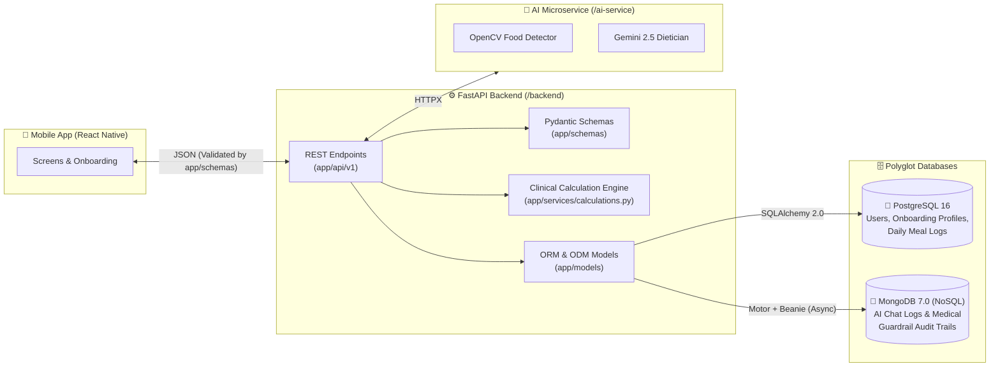
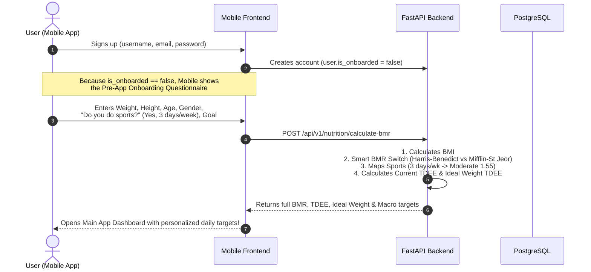

# 🧠 DietAI — Backend & Database Architecture Guide

Welcome to the **DietAI Backend** directory (`/backend`). This README explains the **big picture**, **folder organization**, **database architecture (PostgreSQL + MongoDB)**, and the **Post-Signup Onboarding & Clinical BMR Calculation flow** so any teammate (Mobile/Frontend or AI Service) can understand how the backend works without digging through raw code.

---

## 🗺️ 1. The Big Picture (How Everything Connects)

The backend acts as the central **API Gateway & Business Logic Layer** between the **React Native Mobile App** (`/mobile`), the **AI & Computer Vision Microservice** (`/ai-service`), and our **Polyglot Database Layer** (**PostgreSQL 16 + MongoDB 7.0**).



---

## 📁 2. Folder Structure (Why `models/` and `schemas/` Are Separate)

We follow the **Senior FastAPI Separation of Concerns** pattern:
* **`app/models/` = Database Tables & Collections** (How data is stored in PostgreSQL and MongoDB).
* **`app/schemas/` = API Request & Response Contracts (`BaseModel`)** (What JSON the Mobile App sends and receives).

```text
backend/
├── app/
│   ├── main.py                     # FastAPI entry point, CORS, and router registration
│   ├── core/
│   │   └── config.py               # Environment variables (PostgreSQL, MongoDB, AI URLs)
│   ├── models/                     # 🗄️ DATABASE LAYER (SQLAlchemy 2.0 + Beanie NoSQL)
│   │   ├── __init__.py             # Exports all DB models and session helpers
│   │   ├── database.py             # PostgreSQL engine/session pool + MongoDB async client
│   │   ├── user.py                 # PostgreSQL: `users` & `user_profiles` (Onboarding + BMR)
│   │   ├── nutrition.py            # PostgreSQL: `meal_logs` & `meal_food_items` (Photo logs)
│   │   └── chat_log.py             # MongoDB (NoSQL): `chat_logs` (Chat history & safety flags)
│   ├── schemas/                    # 📦 API CONTRACT LAYER (Pydantic BaseModel DTOs)
│   │   ├── chat.py                 # ChatRequest, ChatResponse
│   │   └── nutrition.py            # BMRCalculationRequest/Response, RecognitionResponse
│   ├── services/                   # 🧮 PURE BUSINESS LOGIC & CLINICAL FORMULAS
│   │   └── calculations.py         # BMI, Smart BMR Switch, TDEE, Ideal Weight, Exchanges
│   └── api/v1/
│       ├── api.py                  # Combines all v1 routers
│       └── endpoints/
│           ├── health.py           # GET  /api/v1/health
│           ├── nutrition.py        # POST /api/v1/nutrition/calculate-bmr, /analyze-photo, etc.
│           └── chat.py             # POST /api/v1/chat/message
└── tests/
    └── test_calculations.py        # Automated pytest unit tests for clinical math formulas
```

---

## 🗄️ 3. Polyglot Database Design (Why PostgreSQL + MongoDB?)

Instead of forcing all data into a single database, we use **Polyglot Persistence**:

### A. PostgreSQL 16 (Relational SQL — `SQLAlchemy 2.0`)
Used for structured data that requires strict relations and foreign keys:
1. **`users` table ([`app/models/user.py`](app/models/user.py)):**
   * Stores `id`, `username`, `email`, `hashed_password`, `is_active`, and **`is_onboarded`** (`bool`).
2. **`user_profiles` table ([`app/models/user.py`](app/models/user.py)):**
   * Linked 1-to-1 with `users.id`. Stores the user's answers from the **Post-Signup Onboarding Questionnaire** (height, weight, age, gender, *"Do you do sports?"*, days/week of exercise, goal, clinical conditions) AND their calculated **BMI, BMR, TDEE, Ideal Weight, and daily macro targets**.
3. **`meal_logs` & `meal_food_items` tables ([`app/models/nutrition.py`](app/models/nutrition.py)):**
   * Stores meals analyzed by the AI camera and individual detected foods on the plate.

### B. MongoDB 7.0 (NoSQL Document Store — `Motor` + `Beanie ODM`)
Used for high-write, flexible-schema conversational & telemetry data:
1. **`chat_logs` collection ([`app/models/chat_log.py`](app/models/chat_log.py)):**
   * Stores `user_id`, `session_id`, `user_message`, `assistant_response`.
   * **`safety_flag_triggered` & `triggered_keywords`:** Audits every time a user asks a forbidden medical diagnosis/prescription question.
   * **`user_context_snapshot` (`dict`):** Schema-less JSON field storing the user's remaining calories and diet state at the exact moment they sent the message.

---

## 🏃‍♂️ 4. User Sign-Up $\rightarrow$ Onboarding $\rightarrow$ Clinical BMR Flow

When a user signs up, they shouldn't be dropped into an empty dashboard without calorie targets. Here is the exact flow between **Mobile Frontend** and **Backend**:



---

## 📡 5. Frontend Integration Guide: `POST /api/v1/nutrition/calculate-bmr`

### What Mobile Frontend Needs to Send:

```json
{
  "weight_kg": 70.0,
  "height_cm": 170.0,
  "age": 30,
  "gender": "male",
  "does_sports": true,
  "sports_days_per_week": 3,
  "goal": "weight_loss",
  "calculation_basis": "current",
  "has_diabetes": false,
  "has_cholesterol": false,
  "has_hypertension": false
}
```

#### Field Breakdown for Frontend Developers:
| Field | Type | Required? | Description |
| :--- | :--- | :---: | :--- |
| `weight_kg` | `float` | **Yes** | Current weight in kg (`> 0`) |
| `height_cm` | `float` | **Yes** | Height in cm (`> 0`) |
| `age` | `int` | **Yes** | Age in years (`1–120`). Used for BMR and age-adjusted Ideal BMI (`21–25`) |
| `gender` | `str` | **Yes** | `"male"` or `"female"` |
| `does_sports` | `bool` | Optional | Onboarding question: *"Spor yapıyor musunuz?"* (`true` / `false`) |
| `sports_days_per_week` | `int` | Optional | Onboarding question: *"Haftada kaç gün?"* (`0–7`). Automatically maps to `1.2` (`0d`), `1.375` (`1-2d`), `1.55` (`3-4d`), `1.725` (`5-6d`), `1.9` (`7d`) |
| `activity_level` | `str` | Optional | Used if `does_sports` isn't sent: `"sedentary"`, `"light"`, `"moderate"`, `"active"`, `"very_active"` |
| `activity_factor` | `float` | Optional | Direct PAL multiplier override (`1.2`, `1.375`, `1.55`, `1.725`, `1.9`) |
| `goal` | `str` | Optional | `"weight_loss"` (`-400 kcal`), `"muscle_gain"` (`+300 kcal`), or `"maintenance"` (default) |
| `calculation_basis` | `str` | Optional | `"current"` (default, uses current weight TDEE) or `"ideal"` (uses ideal weight TDEE) |

### What Backend Returns:

```json
{
  "bmi": 24.22,
  "bmr_formula_used": "revised_harris_benedict",
  "bmr": 1671.67,
  "tdee": 2591.09,
  "activity_level": "moderate",
  "activity_factor": 1.55,
  "ideal_bmi_for_age": 22,
  "ideal_weight_kg": 63.58,
  "ideal_bmr": 1585.66,
  "ideal_tdee": 2457.77,
  "calculation_basis": "current",
  "target_calories": 2191.09,
  "recommended_protein_g": 164.3,
  "recommended_carbs_g": 219.1,
  "recommended_fat_g": 73.0
}
```

### How the Clinical BMR Formula Switch Works ([`app/services/calculations.py`](app/services/calculations.py)):
1. **If $\text{BMI} \le 30$ (Non-obese):** Uses **Revised Harris-Benedict (Roza & Shizgal, 1984)** — the clinical gold standard for general populations.
2. **If $\text{BMI} > 30$ (Obese):** Automatically switches to **Mifflin-St Jeor**, which prevents overestimating basal metabolic rate in individuals with obesity.
3. **Age-Adjusted Ideal Weight:** Determines target BMI based on age bracket ($\le 24 \rightarrow 21$, $25\text{–}34 \rightarrow 22$, $35\text{–}44 \rightarrow 23$, $45\text{–}54 \rightarrow 24$, $55+ \rightarrow 25$) and computes both `ideal_weight_kg` and what the user's `ideal_bmr` and `ideal_tdee` would be at that weight.

---

## 🧪 6. Running Backend & Tests Locally

```bash
cd backend

# 1. Run unit tests for the clinical calculation engine
python -m pytest tests/test_calculations.py -v

# 2. Start the FastAPI server
uvicorn app.main:app --reload --port 8000

# 3. Open Interactive Swagger UI Docs
# http://localhost:8000/api/v1/docs
```
