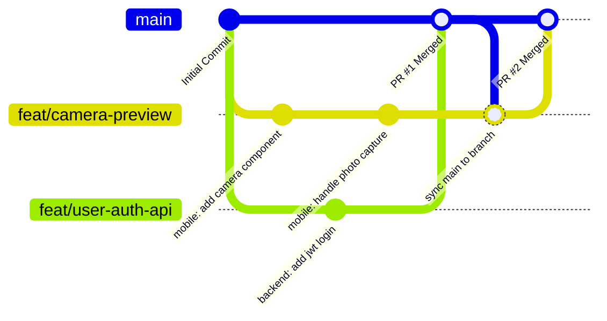

# 👥 Ekip İş Birliği ve Git Çalışma Akışı

> Ana Dokümantasyon Merkezi: [[00-Ana-Giris]]  
> İlgili Rehber: [[02-Monorepo-Kurulum-Rehberi]]

Bu rehber; **Mobil İstemci**, **Arka Yüz (Backend & Veritabanı)** ve **Yapay Zekâ (Bilgisayarlı Görü & LLM)** katmanlarından oluşan bitirme projenizi 3 mühendis olarak sıfır kod çakışması ve yüksek verimlilikle geliştirmeniz için hazırlanmıştır.

---

## 1. Ekip İş Bölümü ve Rol Dağılımı (Sorumluluk Matrisi)

| Rol & Geliştirici | Birincil Sorumluluk Alanı | Temel Teknolojiler & Kütüphaneler | Sahip Olduğu Dizin |
| :--- | :--- | :--- | :--- |
| **Bertan Beyal: Mobil & UI/UX Mimarı** | Mobil uygulama ön yüzü, akıllı kamera entegrasyonu, diyetisyen chatbot arayüzü, yerel durum (state) yönetimi. | React Native (Expo), TypeScript, Tailwind (NativeWind), Zustand | `/mobile` |
| **Eren Torman: Backend & Veritabanı Mimarı** | RESTful API, PostgreSQL şeması, JWT Auth, BMR & Makro hesaplama algoritmaları, API Gateway. | FastAPI, PostgreSQL, SQLAlchemy, Alembic, Docker | `/backend` |
| **Ali Eren Özer: Yapay Zekâ & CV/LLM Uzmanı** | Kamera görüntüsünden yemek tespiti, porsiyon tahmini, Gemini API diyetisyen asistanı, tıbbi güvenlik filtreleri (guardrails). | Python, Gemini API, OpenCV, YOLO, Pydantic | `/ai-service` |

---

## 2. Git & Dal (Branching) İş Akışı

Ekip çalışmasında **`main` dalına doğrudan commit atmak kesinlikle yasaktır.** Kullanılacak model **GitHub Flow** tabanlıdır:

### Altın Kurallar:
1. **Dal (Branch) İsimlendirme Formatı:**
   - `feat/mobile-camera-capture` (Yeni özellik)
   - `feat/backend-bmr-calculator`
   - `feat/ai-gemini-guardrails`
   - `fix/mobile-chat-overflow` (Hata düzeltme)
   - `docs/update-api-contract` (Belgelendirme)
2. **Conventional Commits (Semantik Commitler):**
   - Her commit ne yaptığını açıkça belirtmelidir:
     - `feat(mobile): implement real-time camera viewfinder`
     - `fix(backend): correct BMR formula for sedentary users`
     - `feat(ai): integrate medical advice blocker in chatbot system prompt`
3. **Pull Request (PR) & Birleştirme:**
   - PR açıldığında ekip arkadaşlarını etiketleyin.
   - Birleştirirken **"Squash and Merge"** seçeneğini kullanarak commit geçmişini tertemiz tutun.

---

## 3. API-First Yaklaşımı & Mocking (Paralel Geliştirme Sırrı)

En büyük zaman kaybı; Mobilcinin Backend'i, Backendcinin ise AI modelinin bitmesini beklemesidir. 

**Çözüm:** API Sözleşmesi (`docs/openapi.json`) üzerinden sahte veri (mock data) kullanmaktır.
* Mobilci sahte veriyle ekranları ve kamerayı hemen kodlar (`EXPO_PUBLIC_USE_MOCK_DATA=true`).
* Backendci FastAPI modellerini yazar.
* AI geliştiricisi modelleri eğitip hazırlar.
* Entegrasyon günü sahte veri kapatılır ve sistem tek tıkla çalışır.
