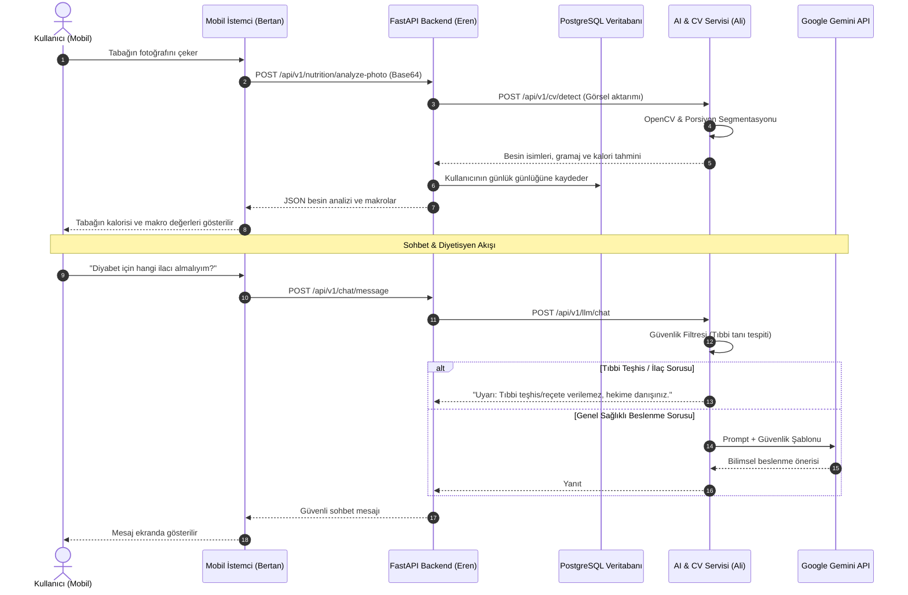

# 🏛️ Sistem Mimarisi, Uçtan Uca Veri Akışı ve Güvenlik Sınırları

> Ana Dokümantasyon Merkezi: [[00-Ana-Giris]]  
> İlgili Kılavuzlar: [[01-Ekip-Is-Birligi-ve-Git-Akisi]], [[04-Mobil-Gelistirici-Yapim-Plani-Bertan]]

Bu belge, **DietAI** projesinin mobil istemcisi, FastAPI arka yüzü, PostgreSQL veritabanı ve yapay zekâ mikroservisi arasındaki mimari iletişimi detaylandırır.

---

## 1. Uçtan Uca Veri Akışı (Sequence Diagram)

---

## 2. Etik ve Yasal Güvenlik Sınırları (Guardrails)

Bitirme projesinin başarısı için sisteme entegre edilen etik filtreler:
1. **Tıbbi Teşhis Yasağı:** Chatbot kesinlikle tıbbi tanı koyamaz ve ilaç tedavisi öneremez.
2. **Güvenli Kalori Sınırı:** Kullanıcıya sağlık açısından tehlike arz eden aşırı düşük kalorili şok diyetler tavsiye edilemez.
3. **Yasal Sorumluluk Reddi:** Mobil ekranda ve API yanıtlarında *"Tüm tahminler yapay zekâ modeli tarafından sunulmakta olup hekim veya klinik diyetisyen reçetesi yerine geçmez"* uyarısı zorunludur.
